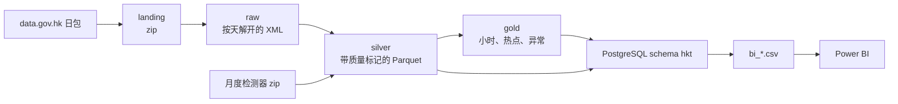

# 学习引导

这份文档带你分三遍看完 `hk-traffic-pipeline`。第一遍只建立架构，不进函数体。第二遍按依赖顺序读模块。第三遍跟一条车道记录，从 zip 走到 Power BI 的 CSV。

你这台机器上已经跑过 2026-10-26 至 2026-10-30。读的时候用磁盘上的产物对照：`data/landing` 里的 zip、`data/silver` 和 `data/gold` 里的 Parquet、`powerbi/bi_data` 里的 7 个 CSV。维度结果是 807 个检测器。

想先在一个能下断点的小项目里把同一条链跑通，用仓库旁边的 [learn-demo](../../../learn-demo/README.md)。那里只有两个很小的 XML。`silver` 和 `gold` 用 Spark，CSV 和 SQLite 代替 Parquet 和 PostgreSQL，步骤和这里的五层一致。

相关文档各管一件事，这里不重复它们：

| 文档 | 什么时候打开 |
|---|---|
| [README.md](../README.md) | 命令、阈值、为什么用 Spark |
| [data_findings.md](data_findings.md) | 真实文件和说明书哪里不一样 |
| [FINDINGS_5_WEEKDAYS.md](FINDINGS_5_WEEKDAYS.md) | 这五天算出了什么结论 |
| [powerbi/BUILD_GUIDE.md](../powerbi/BUILD_GUIDE.md) | CSV 进 Power BI 之后怎么建报告 |

---

## 第一遍：技术架构

### 项目在做什么

运输署通过 data.gov.hk 发布战略道路的检测器数据。每天一包 zip：原始检测器（约每分钟一个 XML，每 30 秒一条车道记录）。另外还有一份月度维度：检测器位置。

管道把这些包变成能回答三件事的表：

1. 哪里、哪个小时最慢（热点）。
2. 某一天的某个小时，比同检测器、同星期类型的常态慢多少（异常）。
3. 这批数据有多完整、有多少坏行（质量）。

速度、拥堵、异常的阈值都是分析约定，写在 `src/hktraffic/config.py` 的 `Settings` 里，可以用 `HKT_*` 环境变量改。它们不是运输署的官方标准。

### 数据经过的五层



| 层 | 目录或库 | 这一层留下什么 | 谁写它 |
|---|---|---|---|
| Landing | `data/landing/*.zip` | 下载来的原包，管道不改内容 | 人 |
| Raw | `data/raw/raw/dt=YYYY-MM-DD/*.xml` | 解开的检测器 XML | `archive.unzip_day` |
| Silver | `data/silver/` | `lane_30s`、`dim_detector`，外加 `_metrics/*.json` | `spark_jobs` |
| Gold | `data/gold/` | `detector_hour`、`hotspots`、`anomalies` | `spark_jobs` |
| Serving | PostgreSQL `hkt` | 小表加 7 个 `bi_*` 视图，再导出 CSV | `serve` |

Silver 的原则是坏行也留下，每行一个 `quality_flag`。Gold 和视图再决定哪些标记能进入速度和拥堵。这样平均值不会被静默改掉，质量问题仍然能在后面数出来。

### 技术各管一段

| 技术 | 用在哪 | 这一段为什么是它 |
|---|---|---|
| 标准库 `zipfile`、`xml.etree` | 解压、解析 | 解析规则要能单独用 pytest 测，不依赖 Spark |
| PySpark 3.5 | Silver 和 Gold | 一天大约一千个 XML、四百万行车道记录；按文件并行解析，再按检测器-小时聚合 |
| PostgreSQL 16 | Serving | Gold 表不大（这五天 `detector_hour` 约 9.2 万行），适合 SQL 和给 BI 的视图 |
| Airflow | `dags/hk_traffic_daily.py` | 可选。它只按顺序调用同一套 CLI，自己不算数 |
| Power BI | `powerbi/` | 读 CSV。报告不连数据库 |

`scan`、`dims`、`run-range` 只需要虚拟环境和 Java。`serve`、`export-bi` 才需要 Docker 里的 `warehouse`。潮汐那一页用检测器小时表按走廊再聚合，见 `bi_corridor_hour`。

### 你已经跑过的那条命令

在管道目录、用 `.venv` 里的 `hktraffic`：

```text
hktraffic scan
hktraffic dims
hktraffic run-range --start 2026-10-26 --end 2026-10-30 --delete-raw
hktraffic serve
hktraffic export-bi --out <DataPath 目录>
```

`run-range` 在一次 Spark 会话里做完：每天解压、写 silver、过质量门，五天都过了再写 gold。`--delete-raw` 在当天 silver 写完后删掉解开的 XML，landing 里的 zip 还在。

Airflow 的日任务是同一条链拆开：`wait_for_archives → unzip → silver → quality_gate → gold → serve`。先把 CLI 读懂，DAG 就是这五个命令的外壳。

### 这一遍结束时你应该能回答

- zip 为什么必须放在 `data/landing`，`data/raw` 里会出现什么。
- Silver 和 Gold 各回答哪一类问题。
- 为什么导出 CSV 之前要先 `serve`。
- 哪几步不需要 PostgreSQL。

---

## 第二遍：一个个模块

按这个顺序读。后面的模块调用前面的，倒过来会在 Spark 里同时碰到解析规则和分布式执行。

| 顺序 | 模块 | 先抓住的一件事 |
|---|---|---|
| 1 | `config.py` | 所有阈值和路径从哪来 |
| 2 | `archive.py` | zip 如何被认出、如何解开 |
| 3 | `parsing.py` | 一个 XML 或 CSV 变成哪些列 |
| 4 | `quality.py` | 一天怎样算“不能进入分析” |
| 5 | `spark_jobs.py` | 解析结果如何变成 Parquet 和小时表 |
| 6 | `sql/serve_schema.sql` 和 `serve.py` | Gold 如何变成 BI 能读的视图 |
| 7 | `cli.py` | 上面的函数怎样串成你敲的命令 |
| 8 | 测试 | 用断言核对你的理解 |
| 稍后 | `spark_worker.py`、`archive_api.py`、`synthetic.py`、`benchmark.py`、DAG | 平台细节和旁路，不参与业务定义 |

每个模块都用同一套读法：

1. 读文件最上面的模块说明。
2. 只看函数名和 docstring，先列出输入和输出。
3. 打开对应测试，看它喂进去的是哪份真实样本。
4. 再读函数体。一次只跟一条分支。

真实样本在 `tests/fixtures/real/`。解析测试几乎都从这里取文件，所以读 `parsing.py` 时把 `tests/test_parsing.py` 放在旁边。

### 1. `config.py`：路径和阈值

`Settings` 是冻结的数据类。默认数据目录是相对路径 `data`，所以命令要在管道目录里跑。`get_settings()` 用 `HKT_*` 覆盖默认值。

读的时候把字段分成两组：

- 路径和运行：`data_dir`、`dsn`、`schema`、`spark_master`、`spark_driver_memory`。
- 分析定义：拥堵速度 20 km/h、占有率 15%、可信速度上限 150、异常的 z、最少基线天数、相对降幅、标准差地板、小时覆盖率 0.5、质量门的文件比例和坏行比例。

这些数字的理由在 README 的 Analytics definitions。这里先记住“改行为就是改这里或改环境变量”，不要在各个作业函数里找魔法数。作业函数接收 `settings`，自己不写死阈值。

### 2. `archive.py`：落地和 raw

这个文件没有 Spark。它只认识 landing 里的 zip。

按这个顺序看函数：

1. `classify_zip`：文件名里有 Raw 和 8 位日期时，直接得到种类和日期。
2. `peek_kind`：文件名是哈希时，打开 zip 看内容。XML 根标签 `<raw_speed_volume_list` 是原始检测器。CSV 表头里的 `aid_id_number` / `device_id` 是检测器。
3. `classify_path`：名字能认就用名字，否则用内容。月度维度 zip 没有 8 位日期，所以这里返回不了，交给 `scan_landing`。
4. `scan_landing` 和 `find_zips`：前者列整目录，后者只取某一天的 raw。维度 zip 按文件名里的 6 位月份排序，`dims` 取最新一份。
5. `unzip_day`：只抽出 `.xml`，用文件名而不是 zip 内路径（避免 zip slip），同样大小的已有文件跳过，先写 `.part` 再替换。
6. `read_csv_bytes`：维度文件可能是裸 CSV，也可能是只含一个 CSV 的 zip。

对照测试：`tests/test_archive.py`，尤其是哈希文件名那条。

这一模块结束时，在 landing 里找一个 `7c383a97…-20261026.zip`，口头说出 `peek_kind` 会返回什么，以及它会解开到 `data/raw` 的哪个 `dt=` 目录。

### 3. `parsing.py`：文件变成行

纯函数。坏文件不抛给调用方，而是返回一行，`parse_error` 里写原因。下游因此少不了文件，质量门也能数到解析失败。

分两块读，每块对着一个测试：

| 函数 | 输入 | 测试 |
|---|---|---|
| `parse_raw_xml` | 一个原始检测器 XML | `test_raw_xml_real_counts`、`test_raw_xml_quirks_of_the_real_file` |
| `parse_detector_csv` | 检测器月度 CSV | `test_detector_csv_real`、`test_detector_road_en_is_a_location_description_not_a_road_name` |

读 `parse_raw_xml` 时对照模块顶部的清单：标准差标签是 `<s.d.>`，方向是带空格的英文而不是代码，车道名是 Fast / Middle / Slow Lane。这些差异是解析器存在的原因。

检测器 CSV 还做了地理和名称整理：`normalise_district`、`split_location`、`enrich_corridors`。路名列实际上是“路 + 附近地标”的位置描述，走廊名是从这里推出来的。先读测试名，再读函数，比从正则开始轻松。

`parse_detector_csv` 返回 `(行, 拒绝行)`。`dims` 打印的 `detector_rejects: 0` 就是第二项的长度。

### 4. `quality.py`：一天能不能往下走

`evaluate` 是纯函数，返回失败原因列表。`check` 在列表非空时抛 `DataQualityError`。Spark 只负责算出 `metrics` 字典。

预期文件数写在 `EXPECTED_FILES`：原始 1440（每分钟一个）。真实归档大约只有七成原始文件，所以默认 `min_file_ratio` 是 0.5，这五天才能通过。

门检查四件事：有没有数据、文件数比例、有没有 `parse_error`、坏标记占比是否超过 `max_flagged_share`。坏标记是 `parse_error`、`invalid_flag`、`missing_value`、`out_of_range`。`no_vehicles` 和 `standstill_candidate` 不算坏。原始数据还可以再查：有维度时，报告数据的检测器是否少于已知检测器的一半。

`run-range` 的行为要在这里看清楚：质量门失败的那天会记下来，但函数返回后仍然会删 raw（如果带了 `--delete-raw`），并且失败日不进入后面的 gold。打开 `cli.py` 的 `cmd_run_range`，看 `failed` 列表怎么从质量门走到 `good`。

测试在 `tests/test_misc.py` 开头几条。

### 5. `spark_jobs.py`：Silver 和 Gold

这是最长的文件。分成三次读，不要一次通读。

**5a. 会话和“一个文件变多行”。** `get_spark` 建立本地 Spark：时区 `Asia/Hong_Kong`，分区覆盖模式 `dynamic`（重跑一天只覆盖这一天），驱动绑在 `127.0.0.1`。Windows 上它还指定 `hktraffic.spark_worker` 作为 Python worker。那个小文件只解决进程退出时套接字缓冲没刷出去的问题，里面没有交通业务，放在本模块最后再看。

`_xml_rows` 用 `binaryFiles` 把每个 XML 读成字节，再调用 `parsing.py` 里的函数。解析仍是纯 Python，Spark 负责把文件分到各核。

**5b. Silver。** `lane_flag_expr` 给每一行一个标记，顺序就是优先级：解析失败、`valid != Y`、缺测、超范围、占有率高但流量为 0（停车候选）、流量为 0（无车，速度没有意义）、其余为 `ok`。`build_silver_lanes` 解析、打标、按 `dt` 写入 `lane_30s`，再读回来汇总成质量门要用的字典。`valid != Y` 的行仍可能带着看起来正常的速度，所以必须先打成 `invalid_flag`，不能拿去平均。

`build_dimensions` 调用解析器，把检测器写成无分区的 Parquet。

**5c. Gold。** 先读 `_read_obs_days` 的 docstring。归档日 `dt` 和观测日 `obs_date` 不是同一件事：某天的包里夹着前一天深夜几分钟的数据。Gold 按观测日过滤，并且会多读后一天的分区。

然后只读这三个函数的 docstring 和聚合键：

| 函数 | 一行代表 | 关键约定 |
|---|---|---|
| `build_detector_hour` | 一个检测器的一个小时 | 速度按 `ok` 行的流量加权；拥堵是“慢且占有率高”或停车候选；覆盖率 = 见到的 30 秒时段 / 120 |
| `build_hotspots` | 一个检测器 | 丢掉低覆盖小时，按平均拥堵占比排名，并用窗口函数取出最堵的那个钟点 |
| `build_anomalies` | 一个检测器的一个小时，相对基线 | 基线是其他天、同一小时、同一 `day_type`；要同时满足最少天数、z 值和相对降幅 |

`build_anomalies` 写出比较过的小时，`is_anomaly` 才标记真正的异常。所以 `bi_anomaly.csv` 有 6 万多行，其中 `is_anomaly = 1` 只有两百多行。

测试：`tests/test_spark.py`。银层用真实小文件，金层用 `synthetic.py` 生成的多天数据，因为五天基线和注入事故在样本文件里没有。

### 6. `serve_schema.sql` 和 `serve.py`：给人和 BI 的那一层

先读 SQL 文件头三行注释：事实表故意没有指向维度的外键。真实数据里有检测器不在维度表中，丢掉这些行会藏起问题，所以视图用 `LEFT JOIN`，缺名字时显示 `(unknown detector)`。

表：`dim_detector`、`fact_detector_hour`、`hotspot`、`anomaly_hour`、`pipeline_run`。

视图和页面的对应关系在 BUILD_GUIDE 的导出表里。读视图时注意三件实现选择：

- `low_coverage`、`is_anomaly` 导出成 0/1。PostgreSQL 的布尔若直接 COPY 成 CSV，会变成 `t`/`f`，Power BI 会当成文字。
- 星期几由 `iso_dow` 映射，不依赖数据库语言环境。
- `bi_corridor_hour` 在视图里再次按流量加权，并且排除低覆盖小时。走廊速度不是检测器速度的简单平均。

`serve.py` 很短。`TABLES` 是允许写入的表白名单，因为表名会拼进 SQL。`upsert` 用主键 `ON CONFLICT DO UPDATE`，同一天重跑是覆盖更新。`export_views` 对每个 `bi_*` 做 `COPY ... CSV HEADER`，编码是 UTF-8 带 BOM。

`cmd_serve` 在 `cli.py` 里把 Parquet `collect()` 成 Python 列表再 upsert。这只适合 Gold 这种已经聚合过的表，不适合把 silver 的几百万行车道记录装进数据库。

测试：`tests/test_serve_db.py`（需要本机 PostgreSQL，标记为 db）。

### 7. `cli.py`：把模块串起来

`build_parser` 是命令清单。业务都在上面的模块里，这里是顺序和退出码。

建议只精读两个函数：

- `cmd_run_range`：你跑过的那条多日命令。看它怎样循环天、怎样跳过缺 zip 的天、怎样把质量门失败隔离开、怎样在全部成功日之后才写 gold。异常检测还要求除当天以外至少有 `anomaly_min_baseline_days` 天（默认 4），所以少于五天时会打印跳过异常。
- `cmd_run_day`：单日版，依次调用 unzip、silver、check，再把 gold 的起止都设成这一天。

其余 `cmd_*` 基本上是“取设置、调一个函数、打印 JSON”。扫一眼即可。

`main` 把日志压到 WARNING，再调用选中的子命令。CLI 在导入时就会导入 `serve`，而 `serve` 导入 `psycopg2`，所以即使只跑 `scan`，环境里也要有这个包。`pip install -e .` 已经把它列为依赖。

### 8. 用测试核对

| 你想确认的理解 | 打开 |
|---|---|
| 哈希 zip、解压可重复、拒绝路径穿越 | `tests/test_archive.py` |
| 真实文件的列和怪癖 | `tests/test_parsing.py` |
| 质量门的边界 | `tests/test_misc.py` 前半 |
| 银层标记和金层异常能否抓到注入事故 | `tests/test_spark.py` |
| 从 zip 到 gold 的 CLI | `test_cli_run_range_end_to_end_with_hash_named_zips` |
| 视图的加权、0/1 标记、CSV 带 BOM | `tests/test_serve_db.py` |

Spark 测试要 Java。数据库测试要 PostgreSQL。解析、归档、质量门的测试两者都不需要，适合先跑：

```powershell
.\.venv\Scripts\python.exe -m pytest tests/test_parsing.py tests/test_archive.py -q
```

### 稍后才读的文件

| 文件 | 它的位置 |
|---|---|
| `spark_worker.py` | Windows 上 Spark 拉起的 Python 进程。把套接字每次写出都刷掉，避免 JVM 读到 EOF。业务计算不在这里 |
| `archive_api.py` | data.gov.hk 历史版本 API 的小客户端，适合抽几个时刻。整天的数据用数据集页面上的日包。作者注明还没对线上 API 跑过 |
| `synthetic.py` | 按真实 XML 的形状造多天数据，并注入拥堵和事故，给金层测试用 |
| `benchmark.py` | 同一天的检测器-小时速度，纯 Python 和 Spark 各算一遍，用来看 Spark 在这台机器上值不值得 |
| `dags/hk_traffic_daily.py` | 传感器等到当天的原始 zip 在，然后用 bash 调 CLI。调度间隔和重试在 DAG 参数里 |

---

## 第三遍：跟一条记录走代码

选 2026-10-26 的原始检测器包，在脑子里走下面这条链。每一步打开右边的函数，确认输入输出和你想的一样。

1. **认出包。** `scan_landing` → `classify_path` → `peek_kind`。哈希文件名加上 XML 根标签，得到 `("raw", 2026-10-26)`。
2. **解开。** `cmd_run_range` 调用 `unzip_day`，XML 落到 `data/raw/raw/dt=2026-10-26/`。
3. **解析一个文件。** `_xml_rows` 把文件字节交给 `parse_raw_xml`。一个 XML 变成多行元组，列就是 `RAW_COLUMNS`：检测器、车道、30 秒时段、速度、占有率、流量、`valid`。
4. **打标记。** `lane_flag_expr` 在 Spark 里加 `quality_flag`。这一步还不丢行。
5. **落下 silver。** `build_silver_lanes` 写入 `data/silver/lane_30s/dt=2026-10-26/`，再 `lane_metrics` 统计各标记的行数。你在终端看到的 `flags={...}` 就是这个字典。`quality.check` 用它决定这一天能不能进 gold。
6. **合成小时。** 五天的 silver 都写完后，`build_detector_hour` 按观测日过滤，按 `(obs_date, hour, detector_id)` 聚合。流量加权速度来自 `_speed_x_volume / ok_volume`。
7. **热点和异常。** `build_hotspots` 读刚写好的 `detector_hour`。`build_anomalies` 对其中一天，用其余几天做基线，写出 `is_anomaly`。
8. **进库。** `cmd_serve` 读 Parquet，`serve.upsert` 写入 `hkt.fact_detector_hour` 等表，`record_run` 写入 `pipeline_run`。
9. **变成 CSV。** `init_schema` 重建视图。`export_views` 把 `bi_detector_hour` 等复制到 `DataPath`。Power BI 里的平均速度、拥堵占比、异常计数都从这些 CSV 来，计算定义已经在视图和 Gold 里完成。

走完后，用两个问题检查自己：

- 一个 `valid = N` 但速度看起来正常的车道，在 silver、在 `wavg_speed`、在质量门里分别处于什么状态？
- 10 月 26 日 23:55 的观测，如果出现在 10 月 27 日的 zip 里，Gold 会把它算进哪一天？依据是 `_read_obs_days` 的哪一段？

---

## 建议的节奏

每天只完成一格。下一格开始前，用该格的问题讲一遍；讲不清就留在这一格。

| 次 | 读 | 做 | 讲得清才往下 |
|---|---|---|---|
| 1 | 本文第一遍，加 README 的 Architecture 和 Analytics | 在资源管理器里打开 landing、silver、gold，对上五层表 | 五层各自的目录和产物 |
| 2 | `config.py`、`archive.py`、`test_archive.py` | 再跑一次 `hktraffic scan`，对照输出和 `scan_landing` 的四个键 | 哈希 zip 为什么还能被认出来 |
| 3 | `parsing.py` 和 `test_parsing.py` | 跑解析测试 | 一个原始 XML 的一行有哪些字段，坏文件去了哪里 |
| 4 | `quality.py`、`lane_flag_expr`、`build_silver_lanes` | 对照 10 月 26 日终端里的 `flags` 计数 | 哪些标记算坏，哪些留下但不能进平均速度 |
| 5 | `_read_obs_days`、`build_detector_hour`、`build_hotspots`、`build_anomalies` | 读 `test_spark.py` 里注入事故的那条测试 | 异常的三个条件分别卡掉什么 |
| 6 | `serve_schema.sql` 的七个视图，再是 `serve.py` | 打开一份 `bi_*.csv` 的表头，在 SQL 里找到同名列 | 走廊速度为什么要在视图里再加权一次 |
| 7 | `cmd_run_range` | 把函数分段，标上“解压 / silver / 质量门 / gold” | 质量门失败的那天还会不会进入热点 |
| 8 | BUILD_GUIDE 和 FINDINGS | 在 Power BI 里对一个你已经能从代码推出的数字 | 报告上的一个数能指回哪个函数 |

第 8 次之后，如果还想看调度，再读 DAG。如果想看 Spark 在这台机器上比纯 Python 快多少，再读 `benchmark.py` 并跑 `hktraffic benchmark`。
